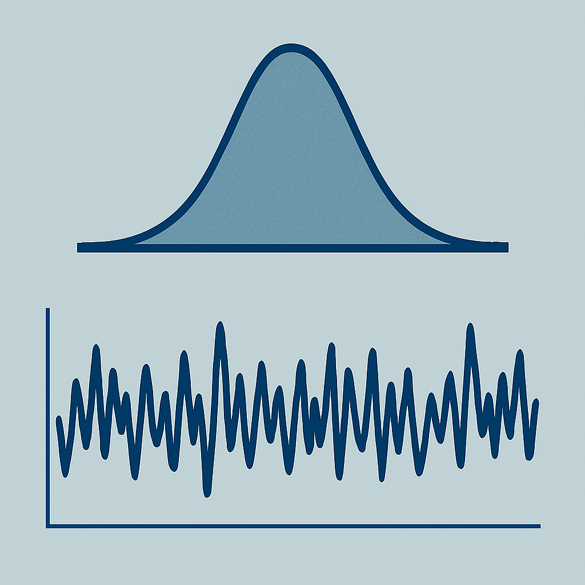

# Bayesian Monte Carlo Markov Chain modelling Cookbook
A guide to coding Bayesian Metropolis Hastings Monte Carlo Markov Chain algorithms from scratch



[](https://github.com/ProjectPythia/bayesian-mcmc-cookbook/actions/workflows/nightly-build.yaml)
[](https://binder.projectpythia.org/v2/gh/ProjectPythia/bayesian-mcmc-cookbook/main?labpath=notebooks)
[](https://doi.org/10.5281/zenodo.23584844)

This Project Pythia Cookbook shows how to write Metropolis-Hastings MCMC samplers from scratch in Python, using only NumPy, SciPy and pandas, and how to apply them to progressively more complex Bayesian models.

## Motivation

While there are many dedicated packages to perform Bayesian estimation (Stan, PyMC, NumPyro, etc.), it is very useful to understand what's under the hood, so scientists and students are better equipped to make good modelling decisions and to diagnose problems when a fit goes wrong. This cookbook demonstrates the role Markov Chain Monte Carlo (MCMC) algorithms play in Bayesian estimation by building samplers by hand, starting from a single normal distribution and moving to regressions and a fisheries population dynamics model.

The cookbook is aimed at students and researchers who know some Python and basic probability, and want to see how a posterior is actually sampled. It does not try to replace the documentation of probabilistic programming languages, and it does not cover gradient-based samplers such as Hamiltonian Monte Carlo/NUTS; it stops at random-walk Metropolis-Hastings and a simple Metropolis-within-Gibbs scheme.

> [!NOTE]
> This cookbook is a work in progress and is actively under construction

## Authors

[Matheus de Barros](https://github.com/matheusbarrosb)

## Structure

### Background

#### Bayes' rule

In Bayesian models, the goal is to estimate the posterior distribution of the parameters $\theta$ given a prior distribution $p(\theta)$ (what we already know about the parameters), and the likelihood $p(y \mid \theta)$ (the probability of observing the data $y$ given parameter values $\theta$).

The joint distribution of data and parameters is

$$
p(y, \theta) = p(y \mid \theta)\, p(\theta)
$$

and applying Bayes' rule

$$
p(\theta \mid y) = \frac{p(y \mid \theta)\, p(\theta)}{p(y)}, \qquad p(y) = \int p(y \mid \theta)\, p(\theta)\, d\theta
$$

where $p(y)$ is the marginal likelihood (normalizing constant). Because $p(y)$ does not depend on $\theta$, the unnormalized posterior is

$$
p(\theta \mid y) \propto p(y \mid \theta)\, p(\theta)
$$

#### The Metropolis-Hastings algorithm

1. **Initialization:** start with an initial value $\theta^{(0)}$.
2. **Proposal:** at iteration $t$, propose $\theta^*$ from $q(\theta^* \mid \theta^{(t-1)})$.
3. **Acceptance ratio:** compute

$$
\alpha = \min\left(1, \frac{p(\theta^* \mid y)\, q(\theta^{(t-1)} \mid \theta^*)}{p(\theta^{(t-1)} \mid y)\, q(\theta^* \mid \theta^{(t-1)})}\right)
$$

4. **Accept or reject:** draw $u \sim \text{Uniform}(0,1)$. If $u < \alpha$, set $\theta^{(t)} = \theta^*$, otherwise $\theta^{(t)} = \theta^{(t-1)}$.
5. **Iterate:** repeat steps 2–4.

Key properties:
- The sequence $\{\theta^{(t)}\}$ is a Markov chain whose stationary distribution is the posterior $p(\theta \mid y)$.
- Only the unnormalized posterior is needed, since $p(y)$ cancels in the ratio.
- With a symmetric proposal (e.g. a normal random walk) the $q$ terms cancel too.
- After discarding a burn-in period, the remaining samples are used for posterior inference.

### Applications

The notebooks are meant to be read in order:

1. **Standard normal**: random-walk Metropolis for a one-dimensional target with no data.
2. **Normal with unknown mean and precision**: a Metropolis step for the mean combined with a Gibbs step for the precision.
3. **Logistic regression**: Metropolis-Hastings for a GLM with a flat prior and with a multivariate normal prior.
4. **Poisson regression**: Metropolis-Hastings with multiple chains for count data.
5. **Schaefer surplus production model**: a Bayesian fisheries stock assessment model fit to catch and survey index data.

## Running the Notebooks

You can either run the notebooks in the Cookbook using [Binder](https://binder.projectpythia.org/) or on your local machine.

### Running on Binder

The simplest way to interact with a Jupyter Notebook is through
[Binder](https://binder.projectpythia.org/), which enables "one click"
execution in the cloud. Navigate to the top right corner of the book chapter you are viewing and click
on the rocket ship icon, then type or paste the Pythia Binder link
(`https://binder.projectpythia.org`) and click "Launch".
After a few moments you should be presented with a
notebook that you can interact with. At first the code cells
have no output, until you execute them by pressing
{kbd}`Shift`\+{kbd}`Enter`. Complete details on how to interact with
a live Jupyter notebook are described in the Pythia Foundations chapter [Getting Started with
Jupyter](https://foundations.projectpythia.org/foundations/getting-started-jupyter).

### Running on Your Own Machine

1. Clone the `https://github.com/ProjectPythia/bayesian-mcmc-cookbook` repository:

   ```bash
   git clone https://github.com/ProjectPythia/bayesian-mcmc-cookbook.git
   ```

1. Move into the `bayesian-mcmc-cookbook` directory
   ```bash
   cd bayesian-mcmc-cookbook
   ```
1. Create and activate your conda environment from the `environment.yml` file
   ```bash
   conda env create -f environment.yml
   conda activate bayesian-mcmc-cookbook
   ```
1. Move into the `notebooks` directory and start up Jupyterlab
   ```bash
   cd notebooks/
   jupyter lab
   ```
